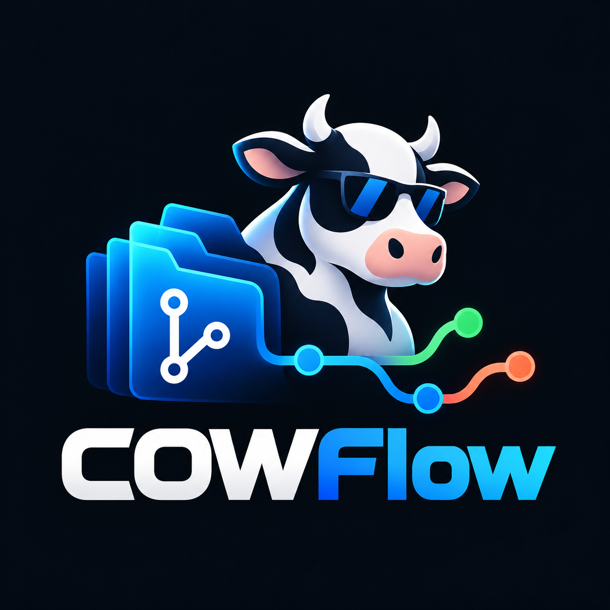

<p align="center">
  
</p>

<h1 align="center">COWFlow</h1>

<p align="center">
  <strong>Isolated execution, shared intelligence, coordinated integration.</strong><br>
  A local runtime for teams of AI agents working in parallel on the same Git repository.
</p>

<p align="center">
  <a href="https://github.com/deverity/COWFlow/actions/workflows/ci.yml"></a>
</p>

---

> **Status: pre-alpha.** The product specification is complete
> ([docs/SCOPE.md](docs/SCOPE.md)); implementation is starting. Nothing here
> is ready for production use yet.

## What it is

COWFlow gives every AI agent its own workspace — directory, branch, and Git
index — created by **physical copy-on-write** whenever the filesystem allows
it (ReFS/Dev Drive, btrfs, XFS, APFS). Agents edit, build, and test without
touching each other's files.

There are **no edit locks**. Instead, agents coordinate explicitly:

- **Intents** — each agent declares what it is about to change before it starts.
- **Cross-requests** — concrete asks between agents ("expose `validateJWT`"),
  with an expected output, an ETA, and a state.
- **Contracts** — versioned interfaces agreed before parallel work begins.
- **Changes and sync** — intermediate commits are published and pulled in
  deliberately, never silently.
- **Integration groups** — related tasks are validated together (build,
  tests, invariants) before a human lead promotes them.

Git remains the source of truth for code. COWFlow adds what Git lacks: task
coordination, discovery of related work, request exchange, derived indexes,
notifications, traceability, and automated integration.

```
Isolate → Announce → Collaborate → Publish → Sync → Validate together → Promote
```

## Highlights (v1 scope)

- Single `cowflow` binary; only depends on `git >= 2.40`.
- Windows-first: Dev Drive (VHDX ReFS) provisioning and native block clone;
  Linux and macOS supported.
- Workspace providers: `cow_clone`, `projfs` (experimental), `git_worktree`,
  `container`.
- Mandatory MCP server for LLM agents; runners for Claude Code, Codex CLI,
  Aider, Gemini CLI, or any generic command, including mixed-vendor teams.
- Scheduler with limits on agents, builds, tests, disk, and LLM budget;
  named resource leases (`compile`, `test-db`, `gpu`).
- Target: 20 concurrent agent sessions on one machine.

See [docs/SCOPE.md](docs/SCOPE.md) for the full specification.

## Building from source

Requires Go (version in [go.mod](go.mod)) and Git ≥ 2.40.

```bash
git clone https://github.com/deverity/COWFlow.git
cd COWFlow
go build -o bin/ ./cmd/cowflow
./bin/cowflow version
```

Or install directly:

```bash
go install github.com/deverity/cowflow/cmd/cowflow@latest
```

## Documentation

| Document | Contents |
|---|---|
| [docs/SCOPE.md](docs/SCOPE.md) | Product specification for v1 |
| [docs/sprints/](docs/sprints/README.md) | Sprint plan (one sprint per phase), agent roster, tasks |
| [docs/GITFLOW.md](docs/GITFLOW.md) | Branching model, releases, and repository rules |
| [CONTRIBUTING.md](CONTRIBUTING.md) | How to contribute |
| [AGENTS.md](AGENTS.md) | Rules for AI agents working on this repo; skills in [docs/skill/](docs/skill/README.md) |
| [SECURITY.md](SECURITY.md) | How to report vulnerabilities |
| [CHANGELOG.md](CHANGELOG.md) | Release history |

## Contributing

Contributions are welcome. Read [CONTRIBUTING.md](CONTRIBUTING.md) first —
all commits must be signed and signed off (DCO), and every change goes
through a pull request against `develop`.

## License

TODO: license not chosen yet.
