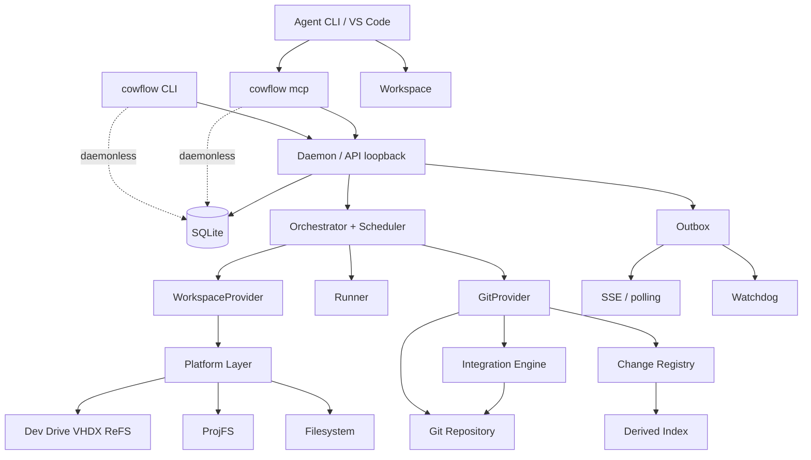

# COWFlow — Scope v1 (functional product)

> **Status:** product specification, version 1.2  
> **Language:** Go (1.23+)  
> **Primary platform:** Windows 11 (Dev Drive / VHDX ReFS)  
> **Supported platforms:** Windows, Linux, macOS  
> **Target load:** 20 concurrent agent sessions on one machine  
> **Model:** isolated execution per COW workspace + explicit, mandatory collaboration + coordinated Git integration

---

## 1. Executive summary

**COWFlow** is a local runtime/orchestrator for teams of AI agents working in parallel on the same Git repository. Each agent gets its own workspace (independent directory + branch + Git index) created via **physical copy-on-write** whenever the filesystem allows it. Agents edit, build, and test without touching other agents' workspaces.

COWFlow **does not use edit locks**. Coordination happens through presence, declared intent, objective requests between agents (*cross-requests*), versioned contracts, publishing of intermediate commits, explicit sync, and integration groups validated before promotion.

Git remains the source of truth for code. COWFlow adds what Git lacks: task coordination, discovery of related work, request exchange, derived indexes, notifications, traceability, and automated integration.

### 1.1 Positioning

| | Scion (Anthropic) / Piper / Sapling | COWFlow |
|---|---|---|
| Problem | server scale: 100 GB monorepo, tens of thousands of merges/day | local coordination: 5–50 agents in a normal repo |
| VCS | proprietary, replaces Git | existing Git, zero migration |
| Connectivity | client always online | local-first, works offline |
| Coordination between agents | out of scope | core of the product |
| Validation | post-merge, agent fixes afterward | pre-merge in integration group, human in the loop |
| Cost | uncapped tokens | token/cost budget in the scheduler |

When a customer needs Scion-style storage, it plugs in as an alternative `GitProvider`. The collaboration protocol does not change.

### 1.2 Changes in this version

- **VHDX ReFS is the foundation on Windows.** `cowflow init` provisions a Dev Drive; `cow_clone` uses native block clone. NTFS falls back to worktree with an explicit warning.
- **ProjFS enters v1** as an experimental provider (`projfs`), behind a flag: virtual workspace that materializes files on demand.
- **Sparse checkout by intent scope** reduces what each workspace materializes.
- **Enriched Change** (changeset style): file list with per-file hash and diff stat, for indexes without opening Git.
- **Derived data:** incremental path → tasks/intents/changes index in SQLite.
- **Diff-only gates:** validations that do not need a workspace.
- **Project invariants** checked as a gate; the runtime says "no".
- **Review by intent:** `integration show` presents intent + diff stat + gates, not lines.
- **Watchdog:** optional task that observes events/metrics and opens cross-requests.
- **Post-promotion with auto-revert** as an option for `promotion_mode = "auto"`.
- **Hermetic harness** with fault injection, prioritized.

### 1.3 Changes in v1.2

- **Lead mode in the extension.** Claude Code (or Codex) running in VS Code acts as orchestrator via MCP; flow documented.
- **`.mcp.json` generated by `init`** at the repo root; without it the extension does not see COWFlow.
- **Orchestration MCP tools** (`create_task`, `run`, `create_integration`, `validate`, `promote`, `wait_events`).
- **Formalized runners** with `[runner.<name>]`: Claude Code, Codex CLI, Aider, Gemini CLI, generic.
- **Mixed-vendor team** as a first-class use case; budget and rate limit per provider.
- **Headless permissions** declared per runner; container recommended for untrusted code.
- **Resource leases** (9.8): named semaphores (`compile`, `test-db`, `gpu`) with queue, TTL, announcement, and `cowflow exec --resource`.
- **Project conventions** (24): GitFlow, Conventional Commits, review and communication rules, with enforcement via the `gitflow` preset.

---

## 2. Vision and principles

### 2.1 Vision

> **Isolated execution, shared intelligence, coordinated integration.**

### 2.2 Principles

1. **Isolation before collaboration.** An agent writes only to its own workspace.
2. **No edit locks.** Overlap produces a warning, never a block.
3. **Mandatory protocol, not suggested.** No intent, no publish; no change, no integration. The server refuses; the model does not choose.
4. **Traceable collaboration.** A request has an origin, a destination, an expected result, and a state.
5. **Explicit sharing.** A published commit does not appear in someone else's workspace without sync.
6. **Git is the canonical history.** SQLite stores metadata, events, and derived indexes.
7. **Published ≠ integrated ≠ approved.**
8. **Recovery after failure.** The daemon reconciles by observing SQLite, processes, Git, and the filesystem.
9. **Swappable providers.** Workspace, Git, runner, transport, and LLM provider are interfaces.
10. **Explicit capability.** The system reports physical COW, virtual, worktree, or container. It never claims what it does not deliver.
11. **Decomposition before runtime.** Contracts between tasks prevent semantic conflict; the runtime detects, it does not fix.
12. **Human in the loop by default.** Promotion requires the lead until the project automates it.
13. **Refs are global state; minimize them.** One retention ref per change, one branch per task, promotion via compare-and-swap on `target_sha`.
14. **Materialize only what is read.** Sparse and virtual by default when supported.

---

## 3. Scope of v1

### 3.1 Included

- `cowflow` CLI, single binary; depends only on `git >= 2.40`.
- Local daemon, on demand or as a service (Windows svc / systemd / launchd).
- Loopback HTTP API with per-session token.
- SQLite (`modernc.org/sqlite`, no cgo), embedded migrations.
- **Daemonless** mode: CLI and MCP operate directly on SQLite.
- `WorkspaceProvider` with four backends: `cow_clone` (ReFS/btrfs/XFS/APFS), `projfs` (Windows, experimental), `git_worktree` (universal), `container` (interface + optional Docker).
- **Dev Drive provisioning** on Windows (`cowflow init --devdrive`).
- Sparse checkout by intent scope.
- Shared dependency cache.
- Tasks, contracts, sessions, presence, intents, cross-requests, changes, sync, integration groups.
- Derived index path → tasks/intents/changes.
- Event store with transactional outbox; SSE or polling; ACK and dedup.
- Change with retention ref `refs/cowflow/changes/<id>` and per-file manifest.
- Sync by merge (default) or cherry-pick/squash (explicit).
- Integration engine: temporary workspace, deterministic order, gates (workspace and diff-only), invariants, stale detection, promotion with confirmation, optional post-promotion with auto-revert.
- Generic runner + Claude Code adapter (reference); interfaces for Codex/Aider.
- Mandatory MCP server for LLM agents.
- Scheduler with limits on agents, builds, tests, integrations, disk, and LLM budget.
- Optional watchdog.
- `slog` JSON logs, auditing, `/metrics`, timeouts, cancellation with process-tree kill (Job Objects / process group).
- `cowflow doctor`.
- Unit tests, integration tests, concurrency with 20+ sessions, hermetic harness with fault injection, CI on all three platforms.

### 3.2 Out of scope

- Custom filesystem beyond ProjFS as a provider.
- Replacing Git.
- Kubernetes / microservices / distributed scheduler.
- Automatic semantic conflict resolution.
- Invisible automatic sync.
- VM isolation when the provider is not container.
- Provisioning of databases/services per task (only `port_range` and env).
- Web dashboard in v1 (v1: `status --watch` + `/v1/status` JSON). A read-only, embedded web dashboard is planned **post-v1** — see [docs/sprints/sprint-7.md](sprints/sprint-7.md).
- Multi-machine hub (prepared, not implemented).
- Edit locks.

---

## 4. Glossary

- **Project:** repository under management.
- **Task:** objective with description, contracts, dependencies, state.
- **Contract:** interface/API agreed between tasks, in a versioned file.
- **Invariant:** project rule verifiable by command or pattern (e.g., "no module reads `commit log` linearly", "`internal/` does not import `cmd/`").
- **Agent / AgentSession / Lead / Workspace / Intent / Cross-request / Sync request / Integration group / Integration attempt:** as in v1.0.
- **Change:** published, immutable commit, with a retention ref and a **manifest** (files, hashes, stat).
- **Derived data:** indexes computed from changes/intents, cached in SQLite, recomputable.
- **Watchdog:** observer session without a code workspace, with permission to open requests and escalate.
- **Provider / Runner / Transport:** swappable interfaces.

---

## 5. Architecture

### 5.1 Planes

**Execution Plane** — Workspace Manager, Git Provider, Runner, Scheduler, lifecycle, logs.  
**Collaboration Plane** — Presence, Intents, Contracts, Cross-requests, Change Registry, Derived Index, Sync, Integration Engine, Outbox, Watchdog.  
**Platform Layer** — paths, process trees, filesystem capabilities, VHDX, ProjFS, service.

### 5.2 Diagram



### 5.3 Modes

| Mode | Capabilities |
|---|---|
| **daemonless** | tasks, workspaces, intents, requests, changes, manual sync, index, polling |
| **daemon** | + scheduler, runner, heartbeat, SSE, integration engine, watchdog, reconciliation, ProjFS host |

ProjFS requires a live process to answer callbacks; `projfs` workspaces only exist while the daemon is running.

### 5.4 Use with VS Code and lead mode

**Roles.**

| Role | Where it runs | How it talks to COWFlow |
|---|---|---|
| **Lead** | Claude Code / Codex extension in VS Code, or a human | MCP (repo's `.mcp.json`) or CLI |
| **Worker** | headless process spawned by the daemon, one per workspace | MCP with session token |
| **Watchdog** | headless process without a workspace | MCP, read-only + requests |
| **Human** | VS Code / terminal | CLI, `open`, promote approval |

**Typical flow.**

```text
human (VS Code): "implement JWT auth and the orders endpoint"
lead  → cowflow_create_task(auth, contract=contracts/auth-api.md)
      → cowflow_create_task(api, depends=auth)
      → cowflow_run(max_agents=6)
daemon → spawns claude -p in X:/ws/auth, codex exec in X:/ws/api
workers → announce_intent → work
api    → send_request(auth, expose_interface validateJWT) → report_status(blocked)
auth   → accept → commit → publish_change → deliver_request
api    → request_sync(change) → continues → publish_change
lead   → cowflow_wait_events(until=tasks_completed, timeout=300)
      → cowflow_create_integration(auth, api, target=develop)
      → cowflow_validate(group)
human  → cowflow integration show → approves promote   (or promotion_mode=auto)
```

**Lead rules.**

- The lead dispatches and **returns**. It does not stay blocked for hours in the extension session. It follows up with `cowflow_wait_events` (short timeout, returns a cursor) or the human asks again.
- The lead does not edit workers' code. If something needs to change, it opens a cross-request or creates a task.
- The lead can be a pure human: same steps via CLI.
- `cowflow init` writes `.mcp.json` at the repo root pointing to `cowflow mcp --role lead`. The extension picks it up the next time the folder is opened.

**Practical limits.**

- VS Code belongs to the human. `cowflow open <task>` opens a worker's workspace; 2–3 worktrees per window at most (language servers).
- `cowflow integration open <group>` generates a `.code-workspace` with the candidate for review.
- Real parallelism is limited by the **account rate limit**, not by disk. 20 processes on the same login exhaust the limit in minutes. Realistic: 3–6 per subscription account; more with an API key or a **mixed-vendor team** (section 15.3).

---

## 6. Workspaces and COW

### 6.1 Isolation contract

Each workspace: its own path, its own branch, independent `HEAD`/index/files, logs, `.env.cowflow`, `port_range`, relationship with project/task/session/`base_sha`, provider, and capabilities.

A write in A never changes B. Write isolation between cooperating parties, not a sandbox.

### 6.2 Provider

```go
type WorkspaceProvider interface {
    Name() string
    Capabilities(ctx context.Context, root string) (Capabilities, error)
    Create(ctx context.Context, spec WorkspaceSpec) (*Workspace, error)
    Inspect(ctx context.Context, id string) (*WorkspaceStatus, error)
    Destroy(ctx context.Context, id string, opts DestroyOptions) error
}

type Capabilities struct {
    CopyOnWrite      CowKind  // None | Block | Virtual
    SparseSupported  bool
    ProcessIsolation bool
    ResourceLimits   bool
    Filesystem       string   // "refs", "ntfs", "btrfs", "apfs", ...
    RequiresDaemon   bool
}
```

### 6.3 Backends

| Backend | Platforms | COW | Mechanism | v1 status |
|---|---|---|---|---|
| `cow_clone` | Windows (ReFS/Dev Drive), Linux (btrfs/XFS), macOS (APFS) | **Block** | `FSCTL_DUPLICATE_EXTENTS_TO_FILE` / `FICLONE` / `clonefile` | **default when available** |
| `projfs` | Windows 10 1809+ / 11 | **Virtual** | Projected File System, on-demand materialization | experimental, `--provider projfs` |
| `git_worktree` | all | None | `git worktree add` | universal fallback |
| `container` | all with Docker | None (+isolation) | bind/volume of the worktree in a container | optional, build tag |

`provider = "auto"` chooses: `cow_clone` → `git_worktree`. ProjFS is never chosen automatically in v1.

### 6.4 VHDX ReFS (Dev Drive) — foundation on Windows

**Provisioning.** `cowflow init --devdrive <size> [--path C:\cf\cowflow.vhdx] [--letter X]`:

1. Checks for Windows 11 22H2+ and admin privilege (elevates once).
2. Creates a dynamic VHDX via `virtdisk.dll` (`CreateVirtualDisk`) or falls back to PowerShell `New-VHD`.
3. Attaches (`AttachVirtualDisk`), initializes GPT, creates a partition, formats ReFS with the Dev Drive flag (`Format-Volume -DevDrive`).
4. Mounts on a drive letter or a mount point under `C:\cf\`.
5. Registers it in the project state; configures auto-attach at boot (scheduled task or service).
6. Writes `workspace.root`, `cache.*` inside the volume.
7. Suggests excluding the volume in Defender (Dev Drive already reduces scanning by default).

**Clone.** The provider walks the base tree (snapshot of the commit, kept as "golden" per `base_sha`) and, for each file, creates the destination and calls `FSCTL_DUPLICATE_EXTENTS_TO_FILE`. Directories are created; symlinks replicated. Cost: metadata, not data. A workspace is born in seconds regardless of repo size.

**Golden trees.** `cowflow` keeps a cache of materialized trees per `base_sha` (`<root>/golden/<sha>`). The first workspace for a `base_sha` pays for the checkout; subsequent ones clone. GC by LRU and disk budget.

**Failures.** No Dev Drive: `doctor` explains and offers to create one. Volume not mounted: `workspace.pending_mount`, retry, never silently creates on NTFS.

### 6.5 ProjFS — virtual provider (v1, experimental)

**Idea.** Same technology as VFS for Git. The workspace is an empty projected directory: the daemon answers enumeration and read callbacks from the Git objects of `base_sha`; files only exist on disk when read; a write converts the placeholder into a real file. Per-file COW, no VHDX, no initial copy.

**Implementation.** `golang.org/x/sys/windows` + direct calls to `ProjectedFSLib.dll` (`PrjStartVirtualizing`, `PrjMarkDirectoryAsPlaceholder`, callbacks `GetDirectoryEnumeration`, `GetPlaceholderInfo`, `GetFileData`, `Notification`). Backing store: persistent `git cat-file --batch` per repository, with an LRU blob cache.

**Requirements.** `Client-ProjFS` feature enabled (once, admin). Daemon running. Root directory on NTFS or ReFS.

**When it pays off.** Large repos where the agent touches few directories. Combines with sparse: enumeration outside the intent scope optionally returns empty (`projfs.scope_only = true`).

**Known risks.**
- `go build`, `npm install`, Defender, and the indexer enumerate everything and hydrate everything; the gain disappears. Mitigation: `scope_only`, Defender exclusion, shared cache outside the workspace.
- Git inside a ProjFS workspace works (VFS for Git proved it), but `git status` needs `fsmonitor` or becomes slow. v1 sets `core.fsmonitor=true` on projfs workspaces.
- A daemon hang freezes the agent's I/O. Mitigation: timeouts on callbacks, `PrjStopVirtualizing` on shutdown, reconciliation on startup.

**Acceptance metric:** projfs workspace created in < 1 s and, with the agent touching < 10% of the repo, materializes < 20% of the bytes of a full worktree.

### 6.6 Sparse checkout by intent

When the intent declares a scope (`paths`), `git_worktree` and `cow_clone` workspaces apply `git sparse-checkout set <paths> + <always>` (`always` = root, configs, contracts, `go.mod`). The agent can widen it via `cowflow_expand_scope` (MCP), which updates the intent and sparse. A build that needs everything: the task declares `sparse = false`.

### 6.7 Shared cache

```toml
[cache]
pnpm_store   = "X:/cache/pnpm"
go_modcache  = "X:/cache/gomod"
go_cache     = "X:/cache/gobuild"
cargo_target = "X:/cache/cargo-target"   # subdir per workspace
gradle_home  = "X:/cache/gradle"
pip_cache    = "X:/cache/pip"
```

Download caches are shared; build caches without concurrency safety get a subdirectory per workspace. They live on the Dev Drive.

### 6.8 A workspace is not a container

It does not isolate network, ports, env, credentials, or processes. Untrusted code → `container` backend.

---

## 7. Windows — platform requirements

Verified by `cowflow doctor`.

- **Filesystem:** Dev Drive present and mounted; ReFS confirmed; NTFS flagged as no COW.
- **ProjFS:** feature enabled when `projfs` is configured.
- **Paths:** `core.longpaths=true`; `\\?\` above 240 chars; short root; canonicalization `Clean + EvalSymlinks + prefix`.
- **Line endings:** `.gitattributes` with `* text=auto eol=lf`; `core.autocrlf=false` per worktree.
- **Processes:** Job Object with `KILL_ON_JOB_CLOSE`; `CTRL_BREAK` → deadline → `TerminateJobObject`. Unix: `Setpgid` + `SIGTERM` + `SIGKILL`.
- **Handles:** destroy fails → `pending_cleanup` with retry and diagnostics. Defender with volume exclusion.
- **Service:** `cowflow daemon install` via `x/sys/windows/svc`; VHDX auto-attach before the daemon.
- **Shell:** never `cmd.exe` with a string; gates are arrays.

---

## 8. Git, changes, and indexes

### 8.1 Rules

- Branch per task: `cowflow/<project>/<task-slug>`.
- The commit is the unit of sharing.
- Publishing creates `refs/cowflow/changes/<id>`; never merges into the target.
- Sync records SHAs and the result.
- Never rebase a published commit; if it changed → new change, previous one `superseded`.
- Promotion = CAS on `target_sha` under a short lock.
- Git via `exec.Command` with `-C`, `GIT_TERMINAL_PROMPT=0`, timeout.

### 8.2 Change manifest

On publish, COWFlow records, in addition to the SHAs:

```json
{
  "files": [
    { "path": "src/auth/jwt.go", "op": "modify", "blob_before": "<sha>", "blob_after": "<sha>", "add": 42, "del": 7 },
    { "path": "contracts/auth-api.md", "op": "modify", "blob_before": "<sha>", "blob_after": "<sha>", "add": 3, "del": 1 }
  ],
  "stat": { "files": 2, "add": 45, "del": 8 },
  "touches_contracts": ["contracts/auth-api.md"]
}
```

Obtained with `git diff-tree -r --numstat` + `--raw` once. After that, overlap, contract impact, and the index work without touching Git.

### 8.3 Derived index

Tables recomputable from changes and intents:

- `path_index(path_prefix, task_id, intent_id, change_id, kind, updated_at)` — who declared or changed a path.
- `contract_refs(contract_path, task_id)` — who depends on which contract.
- `change_ancestry(change_id, parent_change_id)` — chain of changes per task.

Updated in the same transaction as the publish/intent. `cowflow index rebuild` recomputes from scratch. `cowflow who --path` and overlap detection query only the index.

### 8.4 Sync strategies

| Strategy | Default | Use |
|---|---|---|
| `merge` | **yes** | merges the retention ref; preserves identity |
| `cherry-pick` | explicit | isolated commit; trailer `x-cowflow-source` |
| `squash-merge` | explicit | a single local commit |

### 8.5 Change states

`published → validated → promoted`, or `superseded` / `discarded`. Always visible separately.

---

## 9. Collaboration

### 9.1 Presence

`starting | working | waiting | blocked | publishing | syncing | validating | completed | failed | stopped`, TTL, `blocked` with a reason.

### 9.2 Intent (required)

Task, session, workspace, goal, scope (`paths`), artifacts, dependencies, contracts, `base_sha`, state. Does not reserve paths. Overlap → `intent.overlap` to both sessions via the index.

### 9.3 Cross-requests

States: `open → accepted → delivered → closed`; `rejected` from `open`/`accepted`. Free-form comments. Lead can `close`/`reassign`.

Kinds: `implement | expose_interface | publish | review | test | confirm_contract | fix_incompat`. `expected_output`: `commit | interface | test | contract | answer`.

Waiting: `blocked` + event; declared stub (`stub: true` in the intent); escalate to the lead. Runner injects the three options.

### 9.4 Lead

`lead = "human"` (default) or `agent:<task-id>`. Receives overdue requests (`escalation_after`), disputes, repeated overlaps, promotion requests. Reviews by **intent**: `integration show` presents each task's intent, manifest/stat, touched contracts, gate results, and invariants. Lines only on demand (`--diff`).

### 9.5 Contracts

`contracts = [...]` on the task. Injected into the context; `contract.changed` to dependents; promoting a change that alters a contract referenced by an active task requires the lead.

### 9.6 Invariants

```toml
[[invariants]]
name = "no-cmd-import-in-internal"
kind = "pattern"
deny = ["internal/**: import \"cowflow/cmd"]

[[invariants]]
name = "no-linear-log-scan"
kind = "cmd"
cmd = ["go", "run", "./tools/invariants", "--check", "log-scan"]
```

Run as a gate in every integration group and, optionally, on `change publish` (`check_on_publish = true`). An agent that violates one receives a diagnostic; publishing is refused. The engineer says "no" once, in the TOML; the runtime repeats it.

### 9.7 Watchdog

Special task `kind = "watchdog"`: no code workspace, subscribes to events and `/metrics`, runs with a focused prompt ("you only care about the health of X"). Can open cross-requests, comment, escalate. Does not publish changes. Its own budget. Examples: integration watchdog (slow gates, repeated stale), requests watchdog (too many open), disk watchdog.

### 9.8 Resource leases (shared slots)

Limited machine resources — compiler, test database, GPU, port, license — are declared as **named semaphores**. An agent about to consume one announces, requests a slot, uses it, releases it. It is not an edit lock: it limits **resource consumption**, not file access.

```toml
[[resources]]
name = "compile"
slots = 3
lease_ttl_seconds = 600
queue = "fifo"                  # fifo | priority

[[resources]]
name = "test-db"
slots = 1
lease_ttl_seconds = 900
queue = "priority"

[[resources]]
name = "gpu"
slots = 1
lease_ttl_seconds = 1800
```

**Cycle.**

```text
worker → cowflow_resource_check("compile")        → {slots: 3, free: 1, queue: 0, holders: [...]}
worker → cowflow_resource_acquire("compile", wait=true, timeout=300)
         → {lease_id, acquired: true}  or  {queued: true, position: 2}
daemon → resource.acquired(compile, task=api, free=0)
worker → compiles (renews lease via heartbeat if it exceeds the TTL)
worker → cowflow_resource_release(lease_id)
daemon → resource.released → next in queue receives resource.granted
```

**Rules.**

- A lease belongs to the session. Another agent cannot release yours; the lead can (`cowflow resource revoke`).
- TTL expires → slot returns, `resource.expired` event, session notified. Heartbeat renews an active lease.
- `wait=true` waits via `wait_events`, not polling.
- Queue persisted in SQLite; survives restart; reconciliation expires leases of dead sessions.
- `queue = "priority"`: a task with `priority = high` or a `high` cross-request jumps ahead.
- Integration gates go through the **same** queue (`compile`, `test`). There is no parallel queue for the engine.
- `max_builds`, `max_tests`, `max_integrations_per_target` become aliases for `compile`, `test`, `integrate:<target>`. Old config remains valid.

**Announcement without a lease.** `cowflow_resource_announce("compile", eta_seconds=120)` only notifies; it does not reserve. Others decide to wait or reorder. Zero cost.

**Enforcement.** `cowflow exec --resource compile -- go build ./...` acquires, executes, releases. A task can declare `build_cmd`/`test_cmd`; the runner injects an instruction to use `cowflow exec`. An agent that calls `go build` directly is not blocked, but does not count against the slot; the optional invariant `require_resource_exec` detects it from the process log and opens a diagnostic.

**CLI.**

```powershell
cowflow resources                            # slots, holders, queue, age
cowflow resource acquire|release|revoke|announce <name> [--wait] [--ttl 600]
cowflow exec --resource <name> -- <cmd...>
```

**Events.** `resource.acquired|released|granted|queued|expired|revoked|announced`.

**Table.** `resource_leases(id, resource, session_id, task_id, acquired_at, expires_at, released_at, state)`, `resource_queue(resource, session_id, priority, enqueued_at)`.

### 9.9 Events

`agent.presence_changed`, `intent.created|updated|overlap`, `cross_request.*`, `change.published|superseded|discarded`, `sync.*`, `resource.*`, `integration.created|started|passed|failed|stale|promoted|reverted`, `contract.changed`, `invariant.violated`, `session.lost`, `workspace.pending_cleanup|pending_mount`, `budget.exceeded`.

Transactional outbox, at-least-once, ULID, cursor + ACK.

---

## 10. Integration groups

### 10.1 Flow

1. Lead/orchestrator creates a group with tasks/changes and a `target`.
2. Pins each change's `head_sha` and the `target_sha`.
3. **Diff-only gates** run first, without a workspace: `pattern` invariants, touched contracts, overlap between the group's changes, manifest lint. Failed → stops here, cheaply.
4. Creates a temporary workspace (`cow_clone` of the golden at `target_sha`).
5. Applies changes in topological order; tie → publishing order.
6. Workspace gates: build, test, lint, `cmd` invariants.
7. Conflict/failure → event with stage, SHAs, files; workspace preserved for `keep_failed_hours`.
8. Success → `candidate_sha` validated on top of `target_sha`.
9. Promotion: CAS; target advanced → `stale`, reapplies, reruns gates with `rerun_on_stale`.
10. Records `promoted_sha` and evidence.

### 10.2 Post-promotion (optional)

With `promotion_mode = "auto"` and `post_promotion.enabled = true`: after promoting, runs `post_promotion.gates` on the target branch. Failed → `integration.reverted` (automatic revert commit) + cross-request to the tasks involved + lead notified. Enables high throughput when the project accepts the "test later, fix fast" model.

### 10.3 Policies

`promotion_mode = manual|auto`; `branching = gitflow|trunk`; `max_concurrent_per_target = 1` (serializes only the ref).

---

## 11. Scheduler

```toml
[scheduler]
max_agents = 20
max_builds = 3
max_tests = 6
max_integrations_per_target = 1
session_timeout_seconds = 3600
command_timeout_seconds = 900
retry_limit = 2
retry_backoff_seconds = [30, 120]
workspace_disk_budget_gb = 100
golden_cache_gb = 30

[scheduler.llm]
max_concurrent_requests = 8
tokens_per_hour_budget = 4000000
cost_per_day_budget_usd = 150
on_budget_exceeded = "pause"
```

Persistent queue, pause/resume, `session.lost`, cleanup only when there are no unpreserved changes, golden cache GC by LRU.

---

## 12. Local API

Loopback, JSON, per-session Bearer token scoped to project/task/workspace, `/v1`.

### 12.1 Projects, tasks, workspaces, sessions

```http
POST   /v1/projects
GET    /v1/projects/{id}
POST   /v1/tasks
GET    /v1/tasks/{id}
PATCH  /v1/tasks/{id}
POST   /v1/tasks/{id}/dependencies
POST   /v1/tasks/{id}/run
POST   /v1/tasks/{id}/pause
POST   /v1/tasks/{id}/resume
POST   /v1/workspaces
GET    /v1/workspaces/{id}
DELETE /v1/workspaces/{id}
GET    /v1/sessions/{id}
POST   /v1/sessions/{id}/cancel
```

### 12.2 Presence, intents, contracts, index

```http
POST  /v1/presence/heartbeat
GET   /v1/projects/{id}/presence
POST  /v1/intents
PATCH /v1/intents/{id}
POST  /v1/intents/{id}/expand-scope
GET   /v1/projects/{id}/intents?path=...
GET   /v1/projects/{id}/contracts
GET   /v1/projects/{id}/index?path=...
```

### 12.3 Cross-requests

```http
POST /v1/cross-requests
GET  /v1/cross-requests/{id}
GET  /v1/projects/{id}/cross-requests?status=open&to=...
POST /v1/cross-requests/{id}/accept
POST /v1/cross-requests/{id}/reject
POST /v1/cross-requests/{id}/deliver
POST /v1/cross-requests/{id}/close
POST /v1/cross-requests/{id}/comments
POST /v1/cross-requests/{id}/reassign
```

### 12.4 Changes and sync

```http
POST /v1/changes/publish
GET  /v1/changes/{id}
GET  /v1/changes/{id}/manifest
GET  /v1/projects/{id}/changes?task=...&status=...
POST /v1/changes/{id}/discard
POST /v1/sync-requests
GET  /v1/sync-requests/{id}
POST /v1/sync-requests/{id}/apply
POST /v1/sync-requests/{id}/abort
```

### 12.5 Integration, events, status

```http
POST /v1/integration-groups
GET  /v1/integration-groups/{id}
GET  /v1/integration-groups/{id}/review      # intent + manifest + gates
POST /v1/integration-groups/{id}/validate
POST /v1/integration-groups/{id}/promote
POST /v1/integration-groups/{id}/cancel
GET  /v1/events?project_id=...&after=<cursor>
GET  /v1/events/stream?project_id=...
POST /v1/events/ack
GET  /v1/status
GET  /metrics
```

Input validation, payload ≤ 1 MiB, scope-based authorization, confined paths.

---

## 13. Data model

SQLite WAL, `busy_timeout`, migrations via `embed`.

`projects`, `tasks`, `task_dependencies`, `contracts`, `invariants`, `agent_sessions`, `workspaces`, `golden_trees`, `presence`, `intents`, `cross_requests`, `cross_request_comments`, `changes`, `change_files`, `sync_attempts`, `integration_groups`, `integration_group_members`, `integration_attempts`, `path_index`, `contract_refs`, `change_ancestry`, `resources`, `resource_leases`, `resource_queue`, `events`, `event_deliveries`, `outbox`, `budgets`, `audit_log`.

Prefixed ULID IDs. State + event in the same transaction. Derived indexes are recomputable.

---

## 14. CLI

```powershell
# Setup
cowflow init [--devdrive 50GB] [--provider auto|cow_clone|projfs|git_worktree]   # generates .mcp.json and the lead token
cowflow mcp --role lead|worker|watchdog
cowflow doctor
cowflow daemon start|stop|status|install
cowflow devdrive create|attach|detach|status

# Tasks
cowflow task create auth --base develop --title "Implement JWT" --contract contracts/auth-api.md --paths src/auth
cowflow task create api  --base develop --title "Orders endpoint" --depends auth
cowflow task create guard --kind watchdog --watch integration --runner gemini
cowflow task create api --runner codex
cowflow task list|show|pause|resume <id>
cowflow run --max-agents 20 [--runner claude-code]
cowflow runners list|check                 # checks installed CLIs and versions

# Team
cowflow status [--watch]
cowflow agents
cowflow intents [--path src/auth]
cowflow who --path src/auth
cowflow open <task>

# Cross-requests
cowflow request send auth --kind expose_interface --title "Expose validateJWT" --expect commit
cowflow request list [--open] [--to auth]
cowflow request accept|reject|close|comment|reassign <id>
cowflow request deliver <id> --change <change-id>

# Changes
cowflow change publish --task auth
cowflow change list|show|manifest|discard <id>
cowflow sync <change-id> --into <workspace-id> [--strategy merge|cherry-pick|squash]
cowflow sync status|abort <sync-id>

# Integration
cowflow integration create auth api --target develop
cowflow integration validate|promote|cancel <group-id>
cowflow integration show <group-id> [--diff]
cowflow integration open <group-id>

# Resources
cowflow resources
cowflow resource acquire|release|revoke|announce <name> [--wait] [--ttl 600]
cowflow exec --resource compile -- go build ./...

# Index and diagnostics
cowflow index rebuild
cowflow workspace list|inspect|destroy <id> [--force]
cowflow golden list|gc
cowflow logs --task auth [--follow]
cowflow events [--follow] [--since <cursor>]
cowflow budget

# MCP
cowflow mcp
```

`--json` everywhere. Exit codes: `0` ok, `1` usage, `2` state, `3` conflict, `4` refused by policy.

---

## 15. MCP (mandatory for LLM agents)

Stdio, token via `COWFLOW_SESSION_TOKEN`. The agent does not choose `workspace_id`.

| Tool | Function |
|---|---|
| `cowflow_get_context` | task, workspace, base_sha, contracts, invariants, requests for me, available changes |
| `cowflow_announce_intent` | create/update intent |
| `cowflow_expand_scope` | widen paths (updates sparse) |
| `cowflow_find_collaborators` | path/module index |
| `cowflow_send_request` / `cowflow_reply_request` / `cowflow_deliver_request` | cross-requests |
| `cowflow_publish_change` | publish HEAD (runs invariants if configured) |
| `cowflow_list_changes` | filtered changes |
| `cowflow_request_sync` | sync into my workspace |
| `cowflow_report_status` / `cowflow_report_result` | presence and results |
| `cowflow_resource_check` / `cowflow_resource_acquire` / `cowflow_resource_release` / `cowflow_resource_announce` | shared slots (9.8) |
| `cowflow_escalate` | lead |

### 15.1 Tools by role

| Role | Additional tools |
|---|---|
| **Lead** (`--role lead`) | `cowflow_create_task`, `cowflow_update_task`, `cowflow_run`, `cowflow_pause_task`, `cowflow_create_integration`, `cowflow_validate`, `cowflow_promote`, `cowflow_wait_events`, `cowflow_reassign`, `cowflow_prioritize`, `cowflow_approve_promotion`, `cowflow_resource_revoke`, `cowflow_status` |
| **Worker** | base set from the table above |
| **Watchdog** | `cowflow_subscribe_events`, `cowflow_read_metrics`, `cowflow_send_request`, `cowflow_escalate` |

`cowflow_wait_events(filter, after_cursor, timeout_seconds ≤ 300)` returns events and a new cursor; never blocks beyond the timeout.

The lead token is issued by `cowflow init` to the local user, not per session; scope = entire project. `promote` with `promotion_mode = manual` returns `pending_human_approval` and does not promote.

### 15.2 Generated `.mcp.json`

```json
{
  "mcpServers": {
    "cowflow": {
      "command": "cowflow",
      "args": ["mcp", "--role", "lead", "--project", "."],
      "env": {}
    }
  }
}
```

Workers get their own `.cowflow/mcp.json` in the workspace with `--role worker` and `COWFLOW_SESSION_TOKEN` in `env`.

### 15.3 Runners and mixed-vendor team

The protocol does not depend on the model. Any agent that runs headless in a directory and speaks MCP (or, as a fallback, `cowflow --json` via shell) participates. Claude and GPT do not talk to each other; both talk to the COWFlow API.

```toml
[runner.claude-code]
provider        = "anthropic"
cmd             = ["claude", "-p"]
mcp_config_flag = ["--mcp-config", "{mcp_config}"]
permission_flag = ["--dangerously-skip-permissions"]
context_file    = "CLAUDE.md"
prompt_mode     = "arg"            # arg | stdin | file

[runner.codex]
provider        = "openai"
cmd             = ["codex", "exec"]
mcp_config_flag = ["--config", "mcp_servers.cowflow.command=cowflow"]
permission_flag = ["--full-auto"]
context_file    = "AGENTS.md"
prompt_mode     = "arg"

[runner.aider]
provider        = "openai"
cmd             = ["aider", "--yes"]
mcp_config_flag = []               # uses cowflow --json via shell
permission_flag = []
context_file    = "CONVENTIONS.md"
prompt_mode     = "message"

[runner.gemini]
provider        = "google"
cmd             = ["gemini", "-p"]
mcp_config_flag = []               # reads generated .gemini/settings.json
permission_flag = ["--yolo"]
context_file    = "GEMINI.md"
prompt_mode     = "arg"

[runner.generic]
provider        = "custom"
cmd             = ["{cmd}"]
context_file    = "AGENTS.md"
prompt_mode     = "stdin"
```

Placeholders `{mcp_config}`, `{workspace}`, `{prompt}`, `{task_id}` are substituted by the runner. `cowflow task create --runner codex` chooses per task; `[runner].default` applies to the rest.

**Budget and rate limit per provider:**

```toml
[scheduler.llm.anthropic]
max_concurrent_requests = 5
tokens_per_hour_budget = 2000000
cost_per_day_budget_usd = 80

[scheduler.llm.openai]
max_concurrent_requests = 6
cost_per_day_budget_usd = 60

[scheduler.llm.google]
max_concurrent_requests = 4
cost_per_day_budget_usd = 20
```

The scheduler dispatches per provider; a provider at its limit does not block the others.

**Why mixed pays off:** real parallelism without maxing out a single account; cheap task on a cheap model; cross-review by a different vendor (watchdog or reviewer); lead from any vendor or human.

**Costs of mixed:** adapter per CLI (flags, MCP config, output format); tool-calling quality varies — weak models ignore `announce_intent` more often, the server refuses but rounds are wasted; different context file per runner.

### 15.4 Headless permissions

Workers run without an interactive prompt; each runner declares `permission_flag`. This gives the agent free command execution inside the workspace. Consequences:

- agent code is treated as untrusted (section 17);
- `blocked_patterns` and `check_on_publish` invariants are the first line;
- for client repositories or third-party code, `provider = "container"` with restricted network is the recommendation, not an option.

### 15.5 Enforcement

The runner injects the protocol into the vendor's `context_file`; the API refuses `publish` without intent, `integration` without change, `publish` with a violated invariant. Model-independent.

---

## 16. Go stack

| Area | Choice |
|---|---|
| Go | 1.23+, `CGO_ENABLED=0` |
| CLI | cobra |
| HTTP | `net/http`, manual SSE |
| SQLite | `modernc.org/sqlite` |
| Config | BurntSushi/toml |
| Logs | `log/slog` |
| IDs | oklog/ulid |
| MCP | official MCP Go SDK (fallback `mark3labs/mcp-go`) |
| Windows | `x/sys/windows`: Job Objects, svc, `virtdisk.dll`, `FSCTL_DUPLICATE_EXTENTS_TO_FILE`, `ProjectedFSLib.dll` |
| Linux/macOS | `x/sys/unix`: `FICLONE`, `clonefile` |
| Tests | `testing` + testify, `-race`, hermetic harness |
| Build | goreleaser |

### 16.1 Layout

```text
cowflow/
├── go.mod
├── cmd/cowflow/main.go
├── internal/
│   ├── cli/
│   ├── daemon/
│   ├── api/
│   ├── domain/
│   ├── store/          # sqlite, migrations/, outbox, index
│   ├── git/            # command, branch, publish, manifest, sync, refs
│   ├── workspace/      # provider.go, worktree.go, cowclone.go, golden.go, sparse.go
│   │   ├── cow_windows.go  cow_linux.go  cow_darwin.go
│   │   ├── projfs/     # host, callbacks, blobstore
│   │   └── container/
│   ├── platform/       # paths, process_*, vhdx_windows.go, fscaps_*
│   ├── runner/
│   ├── scheduler/
│   ├── collab/         # presence, intents, contracts, requests, invariants, watchdog
│   ├── integration/    # engine, gates, diffonly, promotion, postpromotion
│   ├── mcp/
│   └── config/
├── docs/               # architecture, api, events, windows, projfs, agent-protocol, decisions/
├── test/
│   ├── harness/        # fake clock, fault injection, disk-full, crash
│   ├── integration/
│   └── fixtures/
└── config.example.toml
```

---

## 17. Security

Per-session scoped token; loopback; no concatenated shell; sanitized names (`check-ref-format`); confined paths; `blocked_patterns` (`.env`, `*.pem`, keys); untrusted agent code → container; auditing of publish/sync/destroy/promote/revert/reassign; rescue of uncommitted changes before destroy; reconciliation reads the actual Git and filesystem; remote credentials belong to the user only. ProjFS: callbacks never serve blobs outside the authorized `base_sha`.

---

## 18. Resilience

| Failure | Behavior |
|---|---|
| Agent crashes | `session.lost`, workspace/logs preserved, retry |
| Daemon restarts | reconciles SQLite × processes × worktrees × ProjFS roots; idempotent `op_id`; resumes outbox |
| Lost event | cursor + redelivery + dedup |
| Sync conflict | nothing overwritten; `conflict` with files; `abort` restores |
| Target advances | `stale` → revalidates |
| Disk full / provider fails | explicit failure; never partial `ready`; compensation |
| Stuck handle | `pending_cleanup` with retry |
| VHDX not mounted | `pending_mount`; auto-attach; never silently falls back to NTFS |
| ProjFS callback timeout | error to the agent, not a hang; daemon restarts virtualization |
| Post-promotion fails | automatic revert + requests + lead |
| LLM budget | pause + lead |

### 18.1 Hermetic harness

`test/harness` provides: fake clock, Git repository on tmpfs, fault injection into the Git subprocess (exit code, timeout, truncated output), simulated disk full, daemon crash between outbox write and delivery, simulated VHDX (interface) and simulated ProjFS (in-memory callbacks). Every scenario in the table above has a test in this harness. Fuzzing of manifest parsers and API payloads.

---

## 19. Phases

### Phase 0 — Foundation (wk. 1–2)
Go module, cobra, TOML, SQLite + migrations, Git wrapper, Windows Platform Layer (Job Objects, longpaths, canonicalization), **VHDX provisioning**, `doctor`, CI on 3 platforms, basic harness.
**Output:** `init --devdrive` creates and mounts a Dev Drive; `doctor` reports ReFS/COW correctly.

### Phase 1 — COW workspaces (wk. 3–4)
`cow_clone` Windows/Linux/macOS, golden trees, `git_worktree` fallback, sparse by paths, dirty detection, rescue, shared cache, `open`.
**Output:** 20 COW workspaces in < 2 s each on a test repo; isolated editing verified; incremental disk measured.

### Phase 2 — Daemonless Collaboration Plane (wk. 5–6)
Intents, requests, changes with manifest, derived index, sync, outbox, polling, contracts, `pattern` invariants.
**Output:** intent → request → publish → sync cycle in two terminals without a daemon; `who --path` via the index.

### Phase 3 — MCP + runners (wk. 7–8)
MCP with lead/worker/watchdog roles, `.mcp.json` via `init`, tokens, generic runner + Claude Code + Codex, per-vendor protocol injection, enforcement, per-provider budget.
**Output:** lead in the VS Code extension creates two tasks; two workers with a real dependency (auth → api), **one Claude and one Codex**, finish the feature without a human editing code. **The test that decides the product.**

### Phase 4 — Daemon, scheduler, SSE (wk. 9–10)
Daemon, API, heartbeat, limits, LLM budget, SSE, reconciliation, Windows service, watchdog.
**Output:** 20 simulated + 5 real under limits; watchdog opens a request upon detecting an anomaly.

### Phase 5 — Integration (wk. 11–12)
Engine, diff-only and workspace gates, `cmd` invariants, stale, manual promotion, review by intent, optional post-promotion.
**Output:** two features validated and promoted with evidence; automatic revert demonstrated in auto mode.

### Phase 6 — ProjFS + hardening (wk. 13–15)
Experimental `projfs` provider, fsmonitor, `scope_only`, measurements; stress, crash, disk full, stuck handle, unmounted VHDX; fuzzing.
**Output:** functional projfs workspace with materialization metrics; all failures in table 18 covered by tests.

---

## 20. Acceptance criteria

1. 20 workspaces with independent branches.
2. Same file edited in two workspaces without interference.
3. Changes attributable by task/session.
4. Publishing refused without intent; integration refused without change; publishing refused with a violated invariant.
5. Change consumed via merge, with conflict recorded when there is one.
6. Complete cross-request with linked change.
7. `blocked` agent unblocked by an event.
8. State survives restart; outbox redelivers.
9. Published/validated/promoted are distinct.
10. Integration group with two features, diff-only gates before workspace, manual promotion.
11. Target advanced → revalidation.
12. Never destroys unpreserved changes without `--force`.
13. `inspect` reports the actual filesystem and `CowKind`.
14. Core and tests on all 3 platforms; limitations in `docs/windows.md` and `docs/projfs.md`.
15. 20+ simulated sessions without event duplication or loss.
16. Cancellation on Windows kills the tree.
17. Shared cache reduces second-workspace setup by ≥ 50%.
18. **Two LLM agents with a real dependency complete a feature end-to-end.**
19. Exceeded budget pauses and notifies.
20. Changed contract notifies dependents and requires the lead.
21. **Dev Drive provisioned by `init`; `cow_clone` creates a workspace from a ≥ 1 GB repo in < 2 s with incremental disk < 1%.**
22. **ProjFS: workspace in < 1 s; materialization < 20% of a worktree when the agent touches < 10% of the repo.**
23. `who --path` answers from the index without invoking Git (verified by mock).
24. Post-promotion in auto mode performs a revert and opens requests on failure.
25. Watchdog detects an injected anomaly and opens a cross-request.
26. Harness covers all failures in section 18 with automated tests.
27. **Lead in the VS Code extension** creates tasks, triggers `run`, follows along with `wait_events`, and creates an integration group via MCP only, without the CLI.
28. **Mixed team**: Claude worker and Codex worker complete a cross-request with each other; the scheduler respects the per-provider limit (verified with limit 1 on one vendor while the other continues).
29. `init` generates a valid `.mcp.json` recognized by the Claude Code extension and by the Codex CLI.
30. **Resource leases:** with `compile.slots = 3` and 6 workers requesting a build, at most 3 run; the others are queued, receive `resource.granted` in order, and a dead session's lease expires and frees the slot.
31. Section 24 conventions applied by `init --conventions gitflow`: a branch outside the pattern is refused in `task create`; a direct commit to `main`/`develop` by an agent is refused; a hotfix promoted to `main` generates an automatic integration group for `develop`.

Additional numeric targets after benchmarking with a representative repository.

---

## 21. Observability

CLI/`/v1/status`/`/metrics`: agents by state, tasks by state and duration, creation/destruction time per provider, `CowKind` and disk per workspace, materialized bytes (projfs), golden cache hit/size, pending events, open/overdue/escalated requests, changes by state, sync conflicts by cause, gate duration, result per group, reverts, retries/cancellations/orphans, tokens and cost per session/task/day.

Logs with `project_id`, `task_id`, `session_id`, `workspace_id`, `request_id`, `change_id`, `group_id`.

---

## 22. Configuration

```toml
[daemon]
bind = "127.0.0.1:8787"
state_dir = "X:/state"
log_level = "info"

[project]
lead = "human"
branching = "gitflow"
default_base = "develop"

[devdrive]
enabled = true
path = "C:/cf/cowflow.vhdx"
mount = "X:"
size_gb = 50
auto_attach = true

[workspace]
provider = "auto"               # auto | cow_clone | projfs | git_worktree | container
root = "X:/ws"
golden_root = "X:/golden"
keep_failed_workspaces = true
keep_failed_hours = 72
cleanup_completed = false
sparse_by_intent = true
port_range_per_workspace = 10
port_range_start = 40000

[workspace.projfs]
enabled = false                 # experimental
scope_only = true
fsmonitor = true
blob_cache_mb = 512

[cache]
pnpm_store   = "X:/cache/pnpm"
go_modcache  = "X:/cache/gomod"
go_cache     = "X:/cache/gobuild"
cargo_target = "X:/cache/cargo-target"

[git]
shared_ref_namespace = "refs/cowflow/changes"
change_retention_days = 30
default_sync_strategy = "merge"
require_gitattributes = true

[scheduler]
max_agents = 20
max_builds = 3
max_tests = 6
max_integrations_per_target = 1
session_timeout_seconds = 3600
command_timeout_seconds = 900
retry_limit = 2
retry_backoff_seconds = [30, 120]
workspace_disk_budget_gb = 100
golden_cache_gb = 30

[scheduler.llm]
max_concurrent_requests = 8
tokens_per_hour_budget = 4000000
cost_per_day_budget_usd = 150
on_budget_exceeded = "pause"

[collaboration]
presence_ttl_seconds = 90
heartbeat_interval_seconds = 20
escalation_after_minutes = 30
event_delivery = "sse"

[integration]
require_validation = true
promotion_mode = "manual"
rerun_on_stale = true
diff_only_first = true

[integration.post_promotion]
enabled = false
gates = ["test"]
auto_revert = true

[[gates]]
name = "build"
cmd = ["go", "build", "./..."]
timeout_seconds = 600
required = true

[[gates]]
name = "test"
cmd = ["go", "test", "./...", "-race"]
timeout_seconds = 900
required = true

[[gates]]
name = "lint"
cmd = ["golangci-lint", "run"]
timeout_seconds = 300
required = false

[[invariants]]
name = "no-cmd-import-in-internal"
kind = "pattern"
deny = ["internal/**: import \"cowflow/cmd"]
check_on_publish = true

[[resources]]
name = "compile"
slots = 3
lease_ttl_seconds = 600
queue = "fifo"

[[resources]]
name = "test"
slots = 6
lease_ttl_seconds = 900
queue = "fifo"

[[resources]]
name = "test-db"
slots = 1
lease_ttl_seconds = 900
queue = "priority"

[conventions]
preset = "gitflow"                 # gitflow | trunk | none
enforce_branch_names = true
enforce_protected_branches = true
enforce_commit_format = true
tag_format = "v{major}.{minor}.{patch}"

[scheduler.llm.anthropic]
max_concurrent_requests = 5
cost_per_day_budget_usd = 80

[scheduler.llm.openai]
max_concurrent_requests = 6
cost_per_day_budget_usd = 60

[runner]
default = "claude-code"
inject_protocol = true
lead = "claude-code"               # runner used when lead = agent:<task>

[runner.claude-code]
provider        = "anthropic"
cmd             = ["claude", "-p"]
mcp_config_flag = ["--mcp-config", "{mcp_config}"]
permission_flag = ["--dangerously-skip-permissions"]
context_file    = "CLAUDE.md"
prompt_mode     = "arg"

[runner.codex]
provider        = "openai"
cmd             = ["codex", "exec"]
mcp_config_flag = ["--config", "mcp_servers.cowflow.command=cowflow"]
permission_flag = ["--full-auto"]
context_file    = "AGENTS.md"
prompt_mode     = "arg"

[watchdog]
enabled = false
budget_tokens_per_hour = 200000

[security]
blocked_patterns = [".env", ".env.*", "*.pem", "*.key", "id_rsa*"]
```

---

## 23. Risks and decisions

### Risks

| Risk | Mitigation |
|---|---|
| Agent ignores protocol | server-side enforcement + injection + visible `blocked` |
| Request blocks agent | `escalation_after`, declared stub, lead |
| Semantic conflict | contracts + `contract.changed` + gates + invariants |
| Dev Drive unavailable (Win10, no admin) | explicit worktree fallback; `doctor` guides |
| VHDX unmounts on boot | auto-attach + `pending_mount`; never silent NTFS |
| ProjFS hydrates everything | `scope_only`, Defender exclusion, external cache; provider stays experimental |
| ProjFS hangs I/O | timeouts, virtualization restart, reconciliation |
| Stuck handles | Job Objects, `pending_cleanup` |
| 20 × node_modules | shared cache on the Dev Drive |
| LLM cost | budget + pause |
| Git × SQLite diverge | reconciliation, `op_id` |
| Derived index gets corrupted | recomputable; `index rebuild` |
| Over-engineering from adversarial review | invariants and lead decide; scope closed per phase |
| Go MCP ecosystem changes | internal adapter |
| Single-account rate limit kills parallelism | per-provider limit + mixed team + API key |
| Vendor CLI changes flags | declarative `[runner.<name>]`; `runners check` detects incompatible version |
| Headless worker with full permissions | `blocked_patterns`, invariants, container recommended for third-party code |
| Lead stuck waiting in the extension | `wait_events` with timeout ≤ 300 s; lead fires and returns |

### Settled decisions

1. Go 1.23+, `CGO_ENABLED=0`.
2. `modernc.org/sqlite`.
3. `net/http`, SSE, daemonless polling.
4. TOML.
5. Array-based runner + Claude Code as reference.
6. Manual promotion, `develop`, human lead.
7. `merge` sync.
8. Local refs; push once a Hub exists.
9. **Windows 11 + Dev Drive VHDX ReFS as the baseline; `cow_clone` by default.**
10. **ProjFS in v1 as an experimental provider, never auto.**
11. Per-file manifest in the change; derived index in SQLite.
12. Diff-only gates before workspace.
13. Web dashboard is post-v1 (Sprint 7): read-only, plain HTML + JavaScript embedded in the binary via `go:embed`, served by the daemon on loopback, live updates over the existing SSE stream. No Node toolchain.

### Open questions

1. Final MCP SDK (Phase 3).
2. Declared stub format.
3. Named pipes as transport (v1.1).
4. Minimum scope of the agent lead.
5. ProjFS: enumerate outside the scope as empty vs lazy (Phase 6 benchmark).
6. Golden tree per `base_sha` vs per branch (Phase 1 benchmark).

---

## 24. Project conventions (best practices)

Conventions COWFlow applies by default to new projects (`init --conventions gitflow`). They are the same rules the human team already follows; the runtime just starts checking them. Existing projects import their own via `[conventions]` and `[[invariants]]`.

### 24.1 GitFlow

Branches:

- `main` → production code (stable release)
- `develop` → continuous integration of features
- `feature/<short-name>` → new features
- `release/<version>` → release preparation
- `hotfix/<version>` → emergency fix on `main`
- `bugfix/<short-name>` → fixes on `develop`
- `chore/<short-name>` → maintenance tasks

Branch rules:

1. **Never** commit directly to `main` or `develop`.
2. Every feature branches off `develop` and goes back to `develop` via PR.
3. Hotfix branches off `main` and is merged into `main` **and** `develop`.
4. Releases branch off `develop`, become a PR to `main`, and are merged back into `develop`.
5. Semantic tags: `vMAJOR.MINOR.PATCH` (e.g., `v1.4.2`).

### 24.2 How COWFlow applies them

| Rule | Mechanism |
|---|---|
| Branch name | `task create --kind feature\|bugfix\|chore\|hotfix\|release` generates `<kind>/<slug>`; non-conforming names rejected |
| Correct base | `feature`, `bugfix`, `chore` → base `develop`; `hotfix` → base `main`; `release` → base `develop`. A different `--base` requires `--force` and is recorded in the audit |
| Never directly on `main`/`develop` | workspace is never created on these branches; `change publish` refuses if `HEAD` is on them; promotion only via integration group |
| Feature goes back to `develop` | integration group with `target = develop` is the only path |
| Hotfix on `main` **and** `develop` | promoting a hotfix to `main` automatically creates integration group `hotfix → develop` and notifies the lead |
| Release | `release/*` promoted to `main` generates tag `v{major}.{minor}.{patch}` (lead confirms version) and a return integration group to `develop` |
| Tags | only the engine creates tags; agents have no permission |
| PR | when remote and forge are configured, promotion opens a PR instead of merging locally; `promotion_mode = "pr"` |

### 24.3 Commits

- Conventional Commits format: `<type>(<scope>): <summary>` — types `feat`, `fix`, `chore`, `refactor`, `test`, `docs`, `perf`, `build`, `ci`.
- Summary ≤ 72 characters, imperative, no trailing period.
- Body explains **why**, not what.
- Mandatory trailers generated by COWFlow on publish: `Cowflow-Task: <task-id>`, `Cowflow-Change: <change-id>`, and `Cowflow-Request: <id>` when it fulfills a cross-request.
- `enforce_commit_format = true` → publish rejects non-conforming commits with a diagnostic.
- Agent does not `--amend` or rebase an already-published commit (8.1).

### 24.4 Code and review

- Every task declares `paths` in its intent; changes outside the scope generate `intent.overlap` or a scope warning and are visible in review.
- Changed contract = public interface change; requires the lead (9.5).
- Tests accompany the change: the `test` gate is `required`. A `feat` change without a new test gets a warning in review (does not block; the project can promote it to an invariant).
- Review by intent first, diff second (9.4).
- No secrets in commits: `blocked_patterns` (17).

### 24.5 Resources and parallelism

- Build and test only via `cowflow exec --resource` (9.8). Compiling directly is allowed, but doesn't count against a slot.
- Announcing before a long operation (`resource_announce`) is expected courtesy; the runner injects it into the protocol.
- An expired lease is not "just one more minute": the TTL expires and the slot is returned. Need more time → renew beforehand.

### 24.6 Agent-to-agent communication

- Question about an interface → `confirm_contract` before implementing, not after.
- Blocked > `escalation_after` → escalate, don't wait in silence.
- A declared stub (`stub: true`) is temporary; a task doesn't enter an integration group with an active stub.
- A rejected request carries the reason in a comment.

### 24.7 Task decomposition

Semantic conflict is avoided here, not at merge time.

- **One task = one branch = one verifiable deliverable.** A task that needs "and also" is two tasks.
- **Fits in one session.** Target: the task finishes within one agent session (≤ `session_timeout`). Larger than that → split it and link via `depends`.
- **Acceptance criteria in the task**, not in the lead's head: `acceptance = ["go test ./internal/auth/... passes", "endpoint POST /orders returns 201"]`. The runner injects them; `report_result` answers item by item.
- **Contract before parallelizing.** If B depends on A, the lead creates the contract (24.8) **before** running both. Running B without A's contract is an explicit choice (`--no-contract`) and is recorded in the audit.
- **Scope declared at creation:** `--paths`. A task without paths gets a warning; the lead may leave it open, but overlap becomes their responsibility.
- **Dependencies are directional and shallow.** `depends` with depth > 2 or a cycle is rejected. A long chain signals a wrong decomposition.
- **Priority has three levels** (`low | normal | high`); `high` is reserved for blocking other tasks or hotfixes.

### 24.8 Contracts

Versioned file at `contracts/<slug>.md`, owner = the task that implements it.

```markdown
# Contract: auth-api
Owner: task auth
Consumers: api, admin
Status: draft | agreed | implemented | deprecated

## Interface
validateJWT(token string) (Claims, error)

## Errors
ErrExpired, ErrInvalidSignature, ErrMissingClaim

## Examples
<minimal input → output for testing>

## Changelog
- 2026-10-19 v1 agreed (lead)
```

Rules:

- `draft` → `agreed` only by the lead. A consumer does not implement against `draft` without `stub: true`.
- A change to an `agreed` contract = `confirm_contract` cross-request to all consumers **before** publish. A publish that changes a contract without an open request is rejected.
- A contract contains no implementation. Only signature, errors, examples, behavioral invariants.
- `deprecated` keeps the file for one release.

### 24.9 Intents

- **Declare before the first file.** First action of the session after `get_context`.
- **Honest scope, not defensive.** Declaring all of `src/` "just to be safe" defeats overlap detection and shows up in review.
- **Update when scope grows.** `expand_scope` before touching anything outside the declared scope, not after. A publish with files outside the intent generates a `scope.exceeded` warning in the manifest.
- **One active intent per session.** Changed goals? Update it, don't create another.
- **Stubs are visible.** `stub: true` lists what was stubbed and which request/contract resolves it.

### 24.10 Publishing and sync

- **Publish early, small, compilable.** A change must pass `compile` on its own over `base_sha`. A broken published change = `change.discarded` by the lead and goes back to the author.
- **Publish before asking.** Whoever opens a cross-request that depends on their own code publishes the current state first, so the other side has context.
- **Supersede, never amend.** Fixed something? New commit, new change; the previous one becomes `superseded` automatically.
- **Target size:** manifest ≤ 20 files or ≤ 800 lines. Above that, review shows a warning; the lead may ask for a split.
- **Sync is deliberate.** Only sync changes the intent needs; reason recorded (`--reason "needs validateJWT"`). Curiosity syncs pollute the workspace.
- **Test after sync.** A successful sync is not a correct sync. Run the scope's `test` before continuing.
- **Sync only published changes.** Never merge a live task's branch. What isn't in `refs/cowflow/changes/` doesn't exist for the others.

### 24.11 Cross-requests

- **One request, one deliverable.** Concrete `expected_output`: signature, file, test. "Help me with auth" is rejected by the server for lacking `expected_output`.
- **Accepting is a commitment with an ETA.** `accept` carries `eta_minutes`. Overran → `resource.announce`-like: a comment with the new ETA, or `reject` with a reason.
- **Reject with a reason and an alternative.** `reject` without a comment is rejected.
- **SLA by priority:** `high` 15 min to respond (accept/reject), `normal` 60 min, `low` no SLA. Missed → automatic `escalation`.
- **Delivery is a linked change.** `deliver` without `change_id` is only accepted for `expected_output = answer`.
- **Whoever asks, closes.** The requester does `close` after sync + test. The lead closes abandoned ones.
- **Don't negotiate implementation in the request.** Disagree with the interface → `confirm_contract`, not an endless thread.

### 24.12 Integration groups

- **Lead creates, engine validates, lead promotes** (until `promotion_mode = auto`).
- **Cohesive group.** Tasks that consume each other go in together; an independent task goes in alone. A large group for convenience hides who broke it.
- **No active stub.** A task with `stub: true` doesn't go in. Resolve the request first.
- **Latest `published` changes per task.** Never `superseded`.
- **Failed → owner fixes.** `integration.failed` opens a `fix_incompat` cross-request to the task flagged by the gate; the group re-enters when the new change is published.
- **Stale is not the agent's fault.** Revalidation is automatic; the agent is only called if reapplying fails.
- **Promotion closes the tasks.** A promoted task becomes `done`; the workspace enters the cleanup policy.

### 24.13 Session and workspace

- **Start:** `get_context` → read contracts → `announce_intent` → `resource_check` for what it will use.
- **Checkpoint:** publish at every compilable milestone, at least every 45 min of active work. A session that dies without publishing loses everything for the team (the workspace remains, but nobody sees it).
- **End:** `report_result` with acceptance criteria answered, `report_status(completed|failed)`. A session without `report_result` is marked `incomplete` in review.
- **Never commit:** `node_modules/`, `.cowflow/`, `*.log`, build artifacts, `.env*`. `init` generates/updates `.gitignore`; publish rejects a manifest with these paths.
- **Ports only from the range.** A service on a port outside the workspace's `port_range` is a log warning and an optional invariant.
- **The workspace is disposable.** Nothing that matters lives only in it. Matters → publish.

### 24.14 Agent boundaries

Forbidden for workers, regardless of runner:

- `git push` to a remote, `git tag`, deleting branches, touching `refs/cowflow/*`.
- Editing another task's `contracts/*` without an accepted `confirm_contract` request.
- Editing `.cowflow/`, `config.toml`, `.mcp.json`, generated `AGENTS.md`/`CLAUDE.md`.
- Installing dependencies outside the shared cache or changing the root `go.mod`/`package.json` without declaring it in the intent (`touches_deps: true`) — generates a warning for the lead.
- Calling `cowflow` with another session's token.

The lead can do all of the above via CLI; it is recorded in the audit.

### 24.15 Budget

- A task has an optional `budget_tokens`; without a value, it inherits from the provider.
- 80% of the budget → warning to the agent and the lead. 100% → session paused, `budget.exceeded`, workspace preserved.
- The agent doesn't "save" by skipping tests. Tests are a gate, not an option.
- Retries due to agent failure count against the same budget.

### 24.16 Definition of Done

A task is done when, in this order:

1. The intent covers everything that was touched.
2. Acceptance criteria answered in `report_result`.
3. Change published, compiles on its own, scope tests pass.
4. Cross-requests it opened: closed. Opened for it: delivered.
5. No active stub.
6. The contract it owns is `implemented`.
7. Validated in an integration group.
8. Promoted.

`cowflow task show` displays the checklist with what's missing.

---

These conventions are the `gitflow` preset. The `trunk` preset replaces 24.1–24.2 with short-lived branches off `main` with direct promotion and keeps 24.3–24.16; `none` disables enforcement and leaves only auditing.

---

## 25. Expected outcome

Multiple agents develop simultaneously in independent COW workspaces, declare what they are going to do, ask for collaboration, publish intermediate commits, consume contributions, respect contracts and invariants, and integrate features under the lead's validation and approval.

**Isolate → Announce → Collaborate → Publish → Sync → Validate together → Promote.**

v1 proves the cycle on Windows with Dev Drive + block clone, delivers ProjFS as the virtual path, and leaves containers, a multi-machine Hub, and Scion-style storage as future providers with no change to the core protocol.
